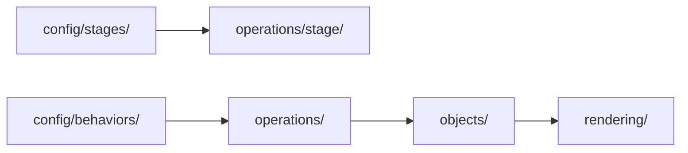

# オブジェクトと操作

## 対象

- IMPLEMENTATIONのI-02「オブジェクトと操作」に関する設計概要。
- 自機、敵、弾などの状態と、それらを生成・更新する処理を分ける。

## 詳細設計

- [objects/](objects_operations/objects.md)で、オブジェクト定義と個体状態の責務を示す。
- [operations/](objects_operations/operations.md)で、入力・行動設定から状態更新へ至る流れを示す。

## 構成要素の責務

| 要素 | 責務 |
|---|---|
| `objects/` | ゲーム内オブジェクトの種類と、個体ごとの状態を保持する。 |
| `operations/player/` | 自機の移動、自動射撃、ダッシュ状態を操作する。 |
| `operations/enemy/` | 敵の生成後の状態更新と、設定された行動・攻撃を操作する。 |
| `operations/projectile/` | 自機弾と敵弾を生成・移動・削除する。 |
| `config/behaviors/` | オブジェクトごとの移動・攻撃などの行動設定を保持する。 |
| `config/stages/` | ステージ進行から参照する敵の出現設定を保持する。 |

## 状態と操作の接続

- `operations/`が`objects/`の状態を更新する。オブジェクト定義自体にステージ進行や他オブジェクトの管理を持たせない。
- 敵の行動処理は、対象の行動設定を`config/behaviors/`から参照する。
- ステージ操作は、`config/stages/`の出現設定を読み、対象の敵と行動設定を生成処理へ渡す。
- 画面描画は`rendering/`が担当し、操作処理から分離する。

## 追加時の境界

- 既存オブジェクトで構成するステージは、ステージ設定を追加して構成する。
- 新しいオブジェクト種は、対応する`objects/`の定義、`operations/`の操作、必要な行動設定を追加する。
- 共通処理が特定の敵やステージの固有動作を直接持たないようにする。
- 具体的な設定形式や、各行動の数値はSPECで定め、ここでは決めない。
