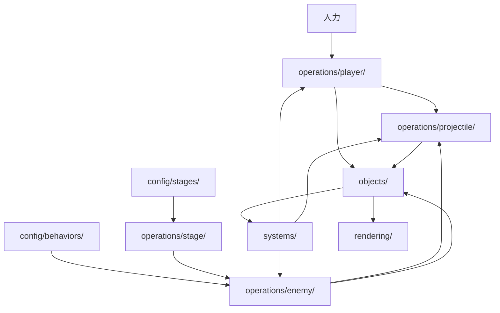

# operations/

## 対象

- IMPLEMENTATIONのI-02「オブジェクトと操作」に関する設計サブフロー。
- 入力・設定に応じたオブジェクトの生成、更新、削除を扱う。

## 構成要素の責務

| 要素 | 責務 |
|---|---|
| `operations/player/` | 入力に応じた自機の移動、ダッシュ、自動射撃を更新する。 |
| `operations/enemy/` | 敵の現在状態と行動設定を使い、移動段階・攻撃段階を更新する。 |
| `operations/projectile/` | 自機弾・敵弾を生成し、移動させ、画面外へ完全に出た弾を削除する。 |
| `operations/stage/` | ステージ設定から出現予定を受け、指定時点で敵の生成を依頼する。 |
| `config/behaviors/` | 敵などの行動設定を、操作処理や個体状態から分けて保持する。 |
| `config/stages/` | ステージごとの敵の出現予定と位置を保持する。 |

## 更新フロー

1. `app/`が更新時の入力を`operations/player/`へ渡す。
2. 自機操作が自機状態を更新し、発射条件を満たすと`operations/projectile/`へ生成を依頼する。
3. ステージ操作が`config/stages/`の予定を参照し、敵操作へ生成を依頼する。
4. 敵操作は個体状態と`config/behaviors/`の設定を参照して状態を更新し、必要に応じて弾の生成を依頼する。
5. 弾操作は位置を更新し、画面外へ完全に出た弾を削除する。
6. 衝突・命中の判定は`systems/`へ委ね、返された結果に応じた状態変更を操作処理で行う。
7. 更新後の状態を`rendering/`が読み取り、画面へ表示する。

## 追加時の境界

- 行動設定の変更や既存操作の組み合わせは、可能な限り`config/behaviors/`または`config/stages/`の追加で行う。
- 新しい行動方式に既存操作を再利用できない場合は、対応する`operations/`の処理を追加する。
- 特定の敵やステージの固有条件を`app/`や共通処理へ埋め込まない。
- 衝突結果の判定方法はI-03の設計へ委ねる。
