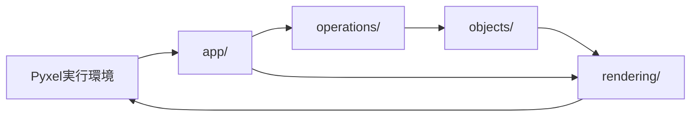

# ゲーム実行基盤

## 対象

- IMPLEMENTATIONのI-01「ゲーム実行基盤」に関する設計概要。
- PC実行とPyxelのHTML出力を対象とする。具体的な起動画面や画面寸法はSPECで未決定のため、ここでは定めない。

## 構成要素の責務

| 要素 | 責務 |
|---|---|
| Pyxel実行環境 | PCまたはブラウザーでゲームを実行し、入力と画面表示を受け持つ。 |
| `app/` | 実行環境とゲーム処理を接続し、更新と描画の呼び出しを調整する。 |
| `operations/` | ゲーム状態の更新と各オブジェクトの操作を行う。 |
| `rendering/` | 現在のゲーム状態を読み取り、画面へ描画する。 |

## 接続と処理の流れ

- 実行環境からの更新呼び出しを`app/`が受け、入力状態を仕様に従って処理へ渡す。
- `app/`はゲーム規則を持たず、必要な`operations/`を呼び出す。
- 更新後の状態は`objects/`に保持し、`rendering/`はその状態を参照して描画する。
- PC実行とHTML出力でゲーム規則を重複実装しない。実行方法の詳細はSPECと外部依存物の規則に従う。

## 設計上の境界

- 起動画面、ステージ開始操作、画面寸法はSPECで決定されるまで追加しない。
- `app/`は実行環境との接続と処理順の調整を担当し、ゲーム状態の個別操作は担当しない。
