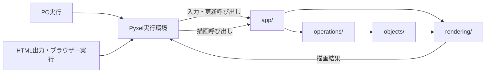

# ゲーム実行基盤

## 対象

- IMPLEMENTATIONのI-01「ゲーム実行基盤」に関する設計。
- PC実行とPyxelのHTML出力によるブラウザー実行を対象とする。
- 画面はSPECで定める固定画面型とし、解像度は256×192ピクセル（4:3）とする。
- 起動時はタイトル画面を挟まず、ステージ1を開始する。

## 構成要素の責務

| 要素 | 責務 |
|---|---|
| Pyxel実行環境 | PCまたはブラウザーでアプリを実行し、入力、更新・描画の呼び出し、画面表示を受け持つ。 |
| `app/` | 実行環境からの起動・入力・更新・描画の呼び出しを受け、ゲーム処理と描画を接続する。 |
| `operations/` | 入力とゲーム規則に従ってゲーム状態を更新する。 |
| `objects/` | 自機、敵、弾など、更新対象となるゲーム状態を保持する。 |
| `rendering/` | 現在のゲーム状態を読み取り、画面へ描画する。 |

## 接続と処理の流れ

1. PC実行またはHTML出力からPyxel実行環境を起動する。
2. 実行環境からの更新呼び出しを`app/`が受け、入力状態を`operations/`へ渡す。
3. `operations/`がゲーム規則に従って状態を更新し、状態は`objects/`に保持する。
4. 実行環境からの描画呼び出しを`app/`が受け、`rendering/`に現在の状態を描画させる。
5. `rendering/`の描画結果を実行環境が画面に表示する。

## 実行環境間の共通化

- PC実行とHTML出力は、同じ`app/`、`operations/`、`objects/`、`rendering/`を使用する。
- 実行環境ごとにゲーム規則や状態更新を重複して実装しない。
- `app/`は実行環境との接続と処理の呼び出しを担当し、個別のゲーム規則を持たない。
- `rendering/`は状態の表示を担当し、ゲーム状態を変更しない。

## 設計上の境界

- 起動後のステージ進行やクリア・再開始の扱いは、ステージ進行設計に委ねる。
- 画面寸法はSPECに従い、256×192ピクセル（4:3）とする。その他の表示詳細はSPECで決定されるまで定めない。
- `operations/`内の個別オブジェクト操作とステージ進行は、対応する設計文書で扱う。
- PCとHTML出力の具体的な作成・実行手順や外部依存物の管理は、それぞれの規則に従う。
