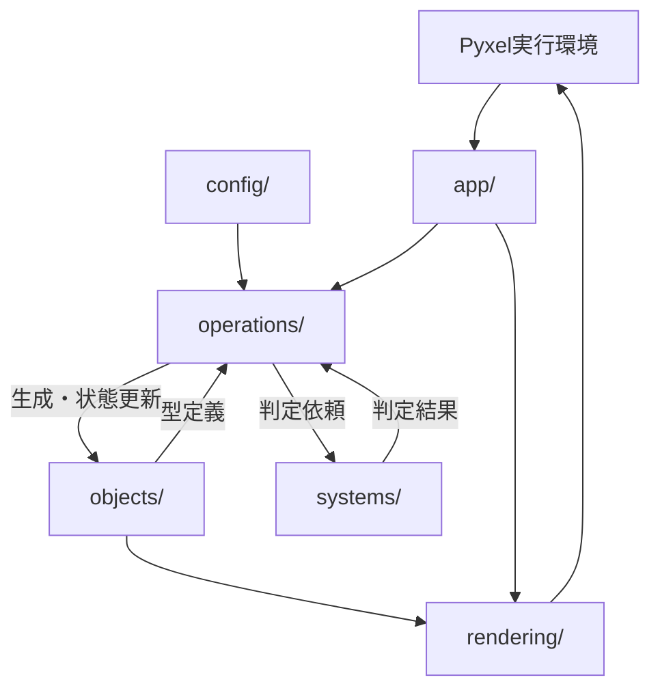
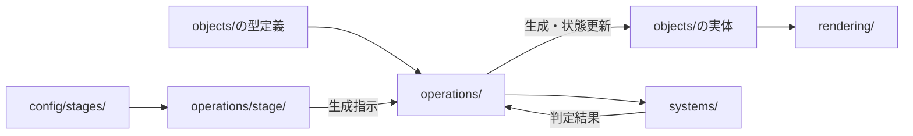
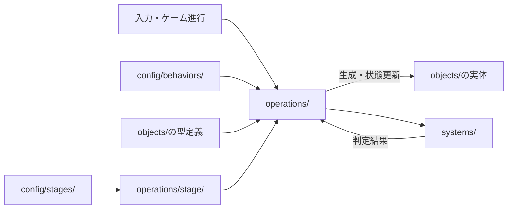

# アーキテクチャ

## 全体構成



## フォルダー構成案

```text
game/
├── app/
├── config/
│   ├── stages/
│   └── behaviors/
├── objects/
│   ├── player/
│   ├── enemy/
│   └── projectile/
├── operations/
│   ├── player/
│   ├── enemy/
│   ├── projectile/
│   └── stage/
├── systems/
└── rendering/
```

`player/`、`enemy/`、`projectile/`は`objects/`と`operations/`内の分類例とする。
全体構成では、オブジェクトと操作を役割ごとにまとめる。

## objects/の流れ



`objects/`はゲーム内オブジェクトの種類と状態をまとめる。
オブジェクトの生成・更新・操作は対応する`operations/`が担当する。

## operations/の流れ



`operations/`はオブジェクト種別ごとの管理・操作をまとめる。
移動や攻撃などの動作設定は`config/behaviors/`に置き、操作処理から参照する。

## 各フォルダーの責務

| フォルダー | 責務 |
|---|---|
| `app/` | Pyxel実行環境とゲーム進行をつなぎ、処理を調整する。 |
| `config/stages/` | ステージごとの出現順・位置・タイミングを設定する。 |
| `config/behaviors/` | オブジェクトの動きや攻撃などの設定を置く。 |
| `objects/` | ゲーム内オブジェクトの種類と状態をまとめる。 |
| `operations/` | オブジェクトやステージの管理・操作をまとめる。 |
| `systems/` | オブジェクト間の当たり判定やダメージ処理をまとめる。 |
| `rendering/` | ゲーム状態を画面へ描画する。 |

## 追加時の構成

- 既存のオブジェクトと行動設定で構成するステージは、`config/stages/`への設定追加で作成できるようにする。共通のステージ進行処理は変更しない。
- 既存オブジェクトの行動設定は`config/behaviors/`に置き、オブジェクト定義や共通処理から分離する。
- 新しいオブジェクト種の追加に必要な定義・操作・行動設定は、それぞれ`objects/`、`operations/`、`config/behaviors/`にまとめる。他の既存オブジェクトや共通処理への変更をできるだけ避ける。
- オブジェクトやステージ設定のファイル形式は未決定とする。
